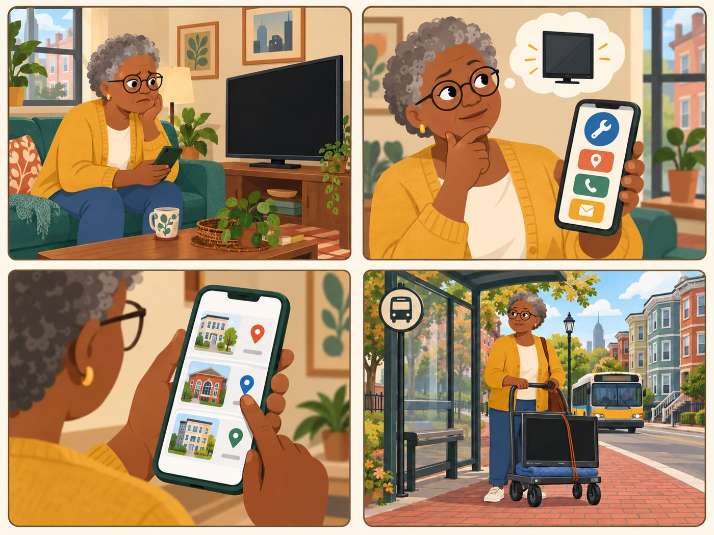

# Denise

**Senior resident. Repair seeker.**

| | |
|---|---|
| Rank | 1 of 15 |
| Likelihood | 5 of 5 |
| Scope | In pilot |
| Source | From team doc |

[Back to the index](README.md)

## Story

1. The TV goes dark. Denise wonders if it is worth fixing.
2. She opens the app. Big buttons. She picks Repair.
3. A short list of places near her. She picks one.
4. She takes the TV on her cart to the clinic by bus.

*Illustration of a fictional person. It is not a photo and not a real user.*

## Source

Team Drive docs "Personas" and "Journey Mapping" (archived 16 May 2026), 11 Aug meeting summary, and the Figma Repair flow. Persona 3 in Figma.

## Why this rank

The team chose her first. The Figma flow, the MVP doc and the user tests all start with her. Repair is the pilot focus.

> I want to know if this is still worth fixing.

## Goals

- Learn if the TV is worth fixing
- Find a free or low-cost fixer near Dorchester
- Know what to bring and when to go

## Main journey

1. **Start.** Has a broken TV. Opens the app.
2. **Choose.** Picks Repair. Names the item.
3. **Search.** Gives zip code and distance. Sees a short list.
4. **Pick.** Opens one provider. Reads address and phone.
5. **Go.** Calls or follows the directions link.

## Edge cases

- Large text and one question per screen. Low digital skill.
- No provider fits: show an empty page with the next-best choice.
- Item cannot be repaired: offer Give away or Find used next.

## Success measure

In a task test with 5 seniors, 4 reach a provider contact for their item without help. Measured by observation, not by tracking.
