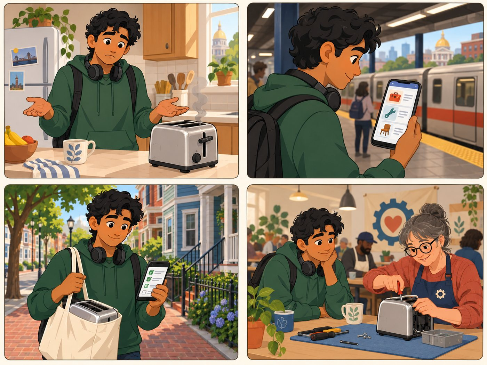

# Jordan

**Commuter with no car. Small-appliance repair.**

| | |
|---|---|
| Rank | 2 of 15 |
| Likelihood | 5 of 5 |
| Scope | In pilot |
| Source | Team Vercel prototype (not Figma) |

[Back to the index](README.md)

## Story

1. The toaster lever breaks. Jordan does not want to bin it.
2. On the train he sees three places, with cost and distance.
3. He reads what to bring. The toaster goes in a tote.
4. A volunteer fixes it with him at a repair cafe.

*Illustration of a fictional person. It is not a photo and not a real user.*

## Source

Team Vercel prototype, Flow A (toaster). Persona from the Persona Crafting doc. Not Figma. All data in it is sample data.

## Why this rank

Young, digital and in a hurry. Needs the least help, so is the easiest user to serve and the easiest to reach.

> Can I get it fixed somewhere near the T?

## Goals

- Fix a toaster, not bin it
- Stay near a T stop
- See cost before going

## Main journey

1. **Start.** Toaster stops working.
2. **Choose.** Taps the item chip.
3. **Compare.** Sees 3 providers with cost and distance.
4. **Check.** Reads what to bring.
5. **Go.** Opens directions in her map app.

## Edge cases

- Walk time and T access are not in the pilot data. Show distance only.
- Provider is closed on arrival. Show the check date.
- Walk-in only: say so. Do not offer booking.

## Success measure

She reaches a provider contact in under 2 minutes from the start page, in a timed test with 5 people.
