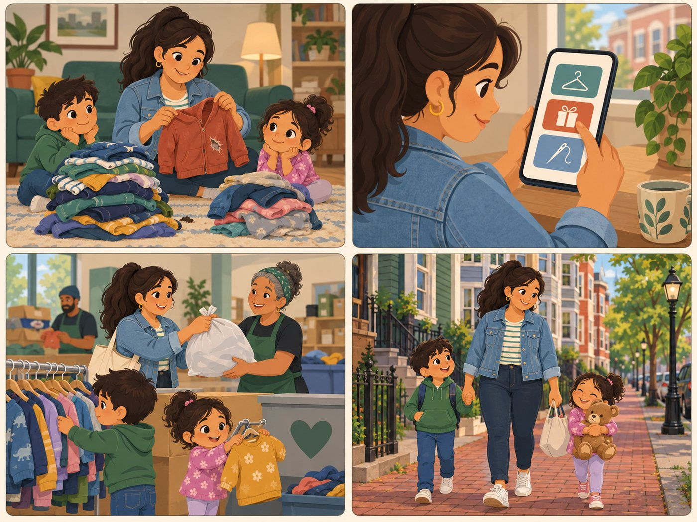

# Marisol

**Parent. Gets and gives in one trip.**

| | |
|---|---|
| Rank | 3 of 15 |
| Likelihood | 4 of 5 |
| Scope | In pilot |
| Source | From team doc |

[Back to the index](README.md)

## Story

1. Two piles: outgrown clothes and one torn jacket.
2. She picks one job at a time: find, give or mend.
3. She gives a bag away. The kids look at the rack.
4. A mended teddy goes home with the family.

*Illustration of a fictional person. It is not a photo and not a real user.*

## Source

Team Drive docs "Personas" and "Journey Mapping" (archived). Needs Spanish text, which the pilot does not have.

## Why this rank

Busy and cost-aware. Her needs (find used, give away, repair) match all three pilot Activities. The language gap is the risk.

> I'll do the hassle if the repair saves me money.

## Goals

- Find cheap kids' clothes and supplies
- Pass on outgrown items
- Repair one sentimental item

## Main journey

1. **Start.** Has two jobs: get and give.
2. **Choose.** Picks one Activity at a time.
3. **Search.** Gets free and low-cost places first.
4. **Compare.** Reads evidence and check date.
5. **Go.** Plans the trip. Uses directions link.

## Edge cases

- No Spanish text yet: a decision is needed (see Open decisions).
- Provider refuses an item: try the next one on the list.
- Shared car: results in distance order, no route plan.

## Success measure

She completes one Give away search and one Find used search in a single visit, in a test, with no help.

## Open decision

Is Spanish text in the pilot?
