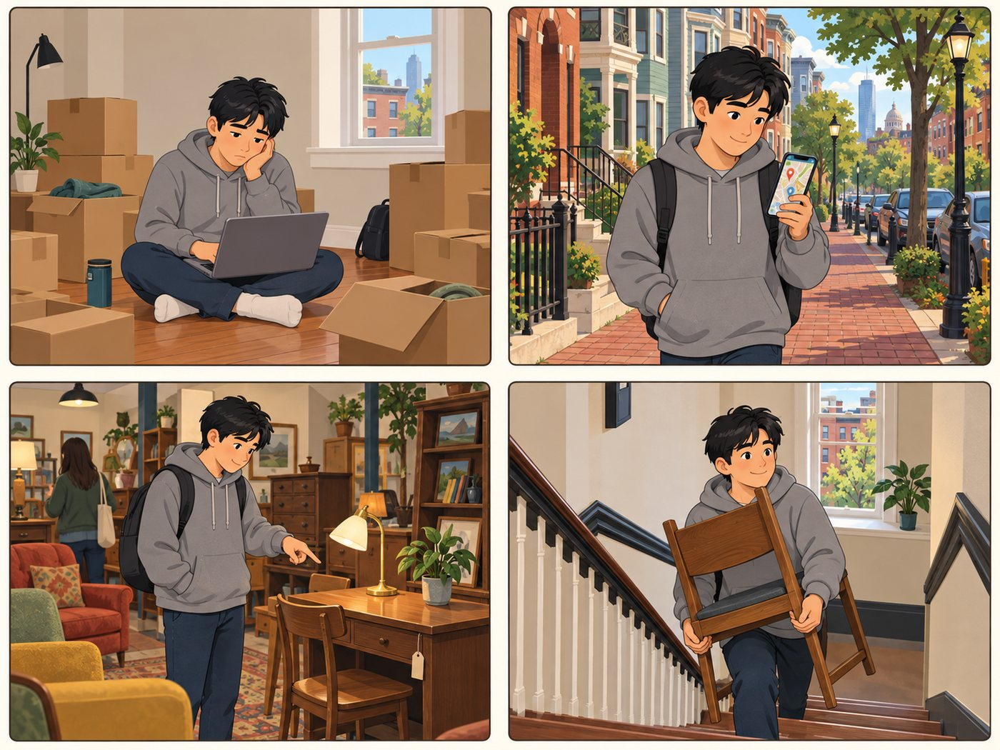

# Jason

**Student renter. Finds used goods.**

| | |
|---|---|
| Rank | 4 of 15 |
| Likelihood | 4 of 5 |
| Scope | In pilot |
| Source | From team doc |

[Back to the index](README.md)

## Story

1. A new flat, empty rooms and boxes. Little money.
2. He walks to the nearest reviewed places.
3. He finds a desk and a lamp at a used shop.
4. He carries a chair up to his new home.

*Illustration of a fictional person. It is not a photo and not a real user.*

## Source

Team Drive docs "Personas" and "Journey Mapping" (archived). Named as "deferred" in the MVP doc. Figma mentions "Persona 1: Student renter" as an entry point.

## Why this rank

Moves often, has little money, and is online all day. The team named him Persona 1. High volume at semester starts.

> I need cheap stuff I can carry to my new home.

## Goals

- Find used furniture and basics
- Stay within walking or T distance
- Do it fast, on a phone

## Main journey

1. **Start.** Moves to Allston. Needs basics.
2. **Choose.** Picks Find used.
3. **Search.** Picks item group. Gives a place name.
4. **Compare.** Sees nearest reviewed places.
5. **Go.** Opens the provider link.

## Edge cases

- No checklist or saved list in the pilot. He bookmarks the page address.
- Stock changes daily: show "Not confirmed" for stock.
- No car: do not promise delivery.

## Success measure

He finds one reviewed place for each of 3 items in under 5 minutes, in a test with 5 students.
