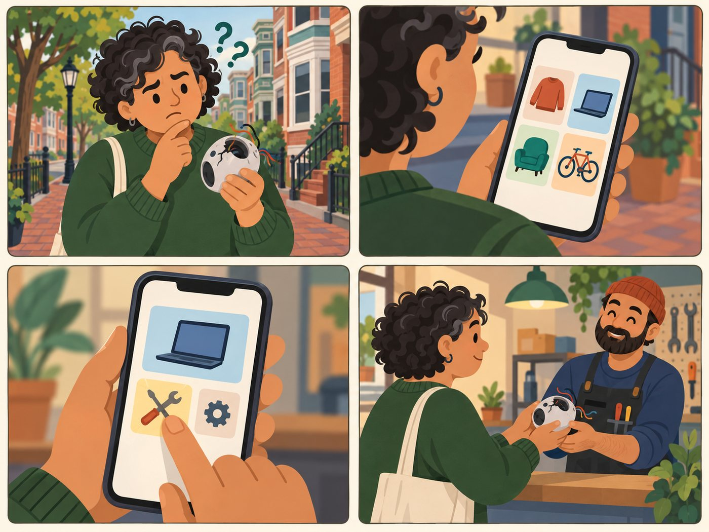

# Resident who does not know what to search

**Browser. Has an item but no word for it.**

| | |
|---|---|
| Rank | 5 of 15 |
| Likelihood | 3 of 5 |
| Scope | In pilot |
| Source | Proposed |

[Back to the index](README.md)

## Story

1. A broken gadget with no name. What now?
2. The app shows picture tiles, not repair words.
3. Two taps: a group, then an item.
4. A repair worker takes the gadget. Relief.

*Illustration of a fictional person. It is not a photo and not a real user.*

## Source

Proposed. It follows from the Figma Decision Tool, which asks "What is your item?" first.

## Why this rank

Many first-time visitors do not know repair words. Browse is the safe path. This is a common case, but it is a way in, not a person.

## Goals

- See what is possible for an item
- Learn the plain words (repair, reuse, give away)
- Not feel lost

## Main journey

1. **Start.** Lands on the home page.
2. **Browse.** Sees item groups, two levels deep.
3. **Pick.** Taps a group, then an item.
4. **See.** Gets the same results as Search.
5. **Go.** Opens a provider contact.

## Edge cases

- An item fits two groups: show once, keep an alias.
- A group with no provider: remove the tile at build time.
- Terms: the City says "repurpose" for donate. Explain in one line.

## Success measure

4 of 5 first-time testers reach a result by Browse alone, with no typing.
