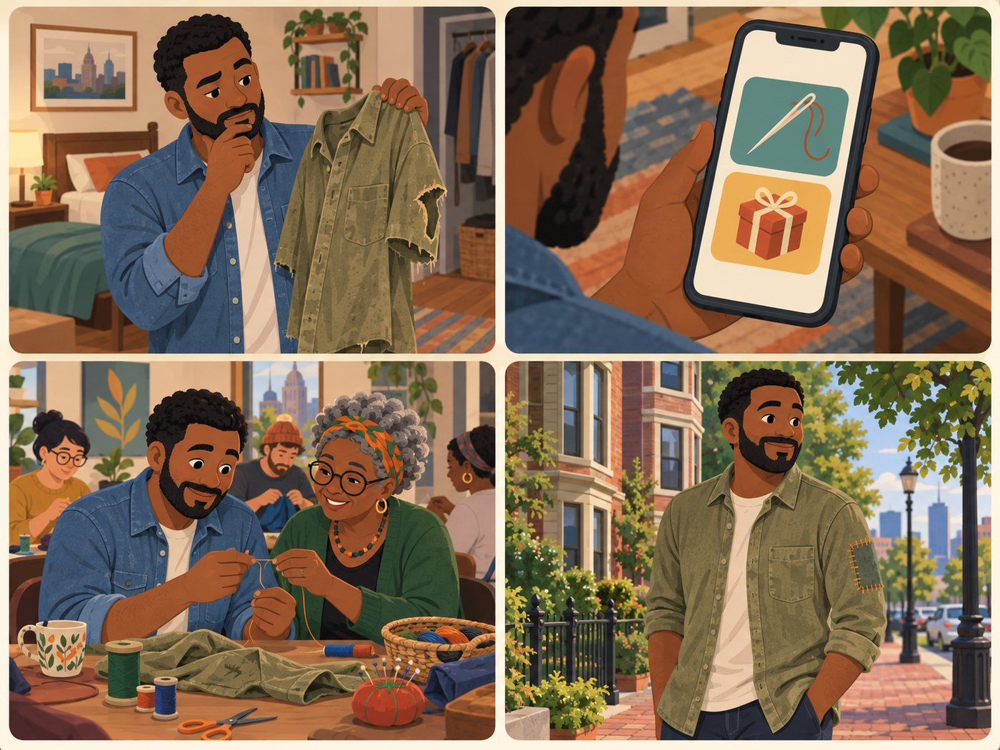

# Mender or clothes donor

**Has an old shirt. Mend, swap or donate.**

| | |
|---|---|
| Rank | 6 of 15 |
| Likelihood | 3 of 5 |
| Scope | In pilot |
| Source | Team Vercel prototype (not Figma) |

[Back to the index](README.md)

## Story

1. An old shirt with a torn sleeve.
2. Mend it, or give it away? He chooses.
3. A mending circle helps him thread the needle.
4. He wears the mended shirt.

*Illustration of a fictional person. It is not a photo and not a real user.*

## Source

Team Vercel prototype, Flow B (shirt). Sample data. Mend and donate choices; "swap" is roadmap.

## Why this rank

Textile repair is the MVP focus in the team docs. Clothes are the item people hold most often.

## Goals

- Decide: mend, pay for repair, swap or donate
- Learn to mend
- Keep the shirt out of the bin

## Main journey

1. **Start.** Has an old shirt.
2. **Choose.** Picks an intent: mend or donate.
3. **Compare.** Sees free and paid options.
4. **Filter.** Free only or this week.
5. **Go.** Opens the option contact.

## Edge cases

- "Swap" needs a match between two people: roadmap.
- "Confirm this option" implies booking: not in the pilot.
- Donation site does not take the item: show accepted items.

## Success measure

3 of 5 testers pick a next step for the shirt and say why in one sentence.
