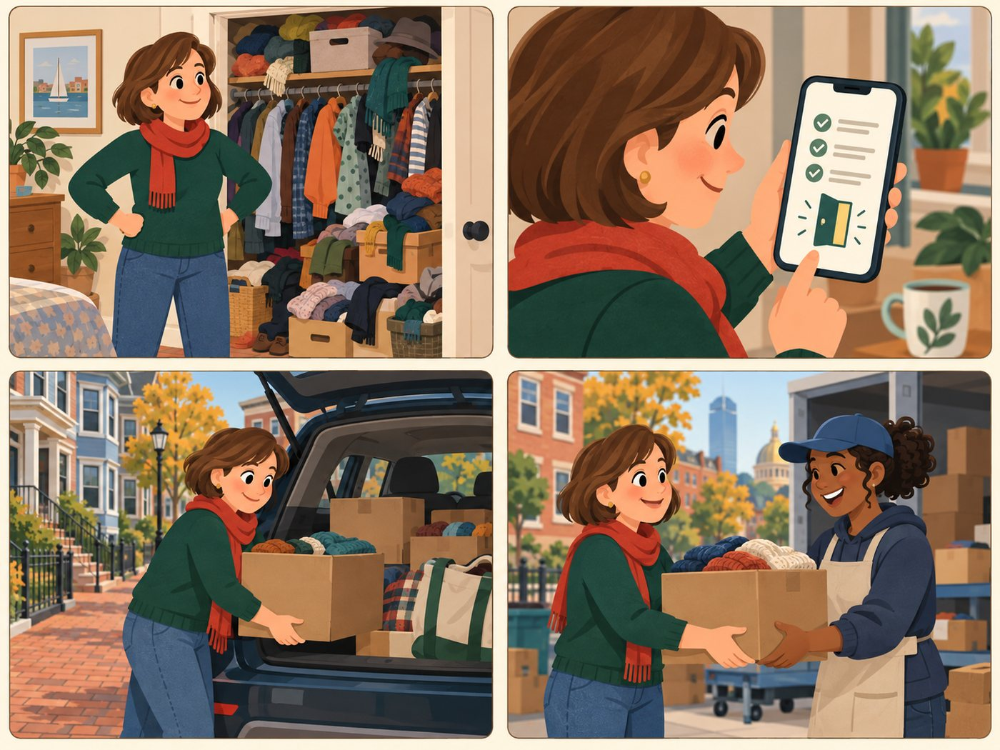

# Give-away donor

**Has usable goods to pass on.**

| | |
|---|---|
| Rank | 7 of 15 |
| Likelihood | 3 of 5 |
| Scope | In pilot |
| Source | Proposed |

[Back to the index](README.md)

## Story

1. A full closet. Time to pass things on.
2. The app shows places that take her items today.
3. She loads the car.
4. A volunteer takes the box. Done in one trip.

*Illustration of a fictional person. It is not a photo and not a real user.*

## Source

Proposed. "Give away" is one of the three pilot Activities. The Figma Reuse card says it includes donate.

## Why this rank

Moves, cleanouts and gifts create many donors. They want a fast, low-effort yes or no.

## Goals

- Find a place that takes the item
- Know hours and what they accept
- Avoid a wasted trip

## Main journey

1. **Start.** Clears a closet.
2. **Choose.** Picks Give away.
3. **Search.** Names the item and her area.
4. **Check.** Sees accepted items and check date.
5. **Go.** Drives or walks to drop off.

## Edge cases

- Item is not accepted anywhere nearby: say so plainly.
- Pick-up services need booking: link only.
- Tax receipt questions: out of scope, link to the provider.

## Success measure

4 of 5 testers find an accepting place for a test item. Zero are sent to a place with no proof.
