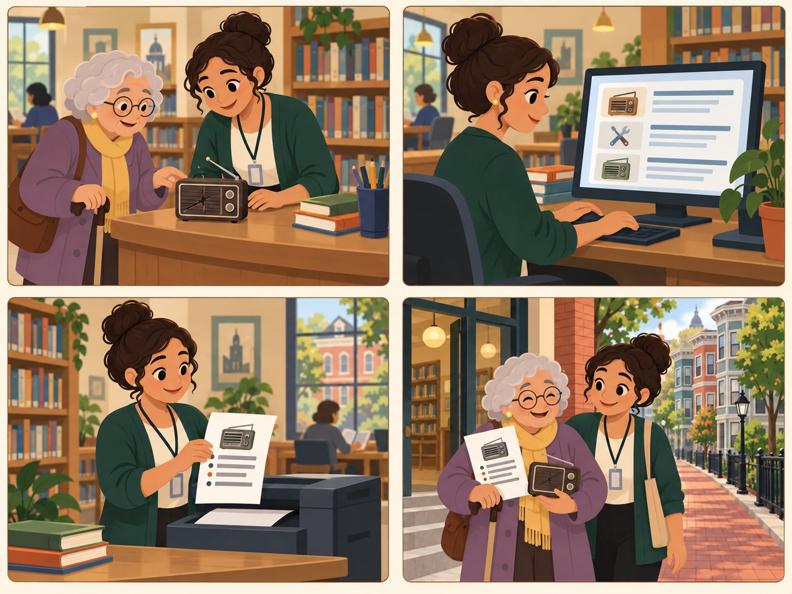

# Community helper

**Helps a resident use the app (for example library staff, a neighbour, a relative).**

| | |
|---|---|
| Rank | 8 of 15 |
| Likelihood | 3 of 5 |
| Scope | In pilot |
| Source | Proposed |

[Back to the index](README.md)

## Story

1. A senior brings a broken radio to the library desk.
2. Rosa runs the search. Large screen, short list.
3. She prints a large-text result page.
4. The senior leaves with the page and a plan.

*Illustration of a fictional person. It is not a photo and not a real user.*

## Source

Proposed. Team docs: low-digital-skill seniors (Denise), Spanish-language need (Marisol), and "word of mouth" as the main way people hear of the app.

## Why this rank

Many seniors will use the app with help. The helper is a real user who reads the screen aloud and shares the link.

## Goals

- Do the search for someone else
- Share the result by text or print
- Explain the choice in plain words

## Main journey

1. **Start.** Sits with the resident.
2. **Search.** Types the item and zip code.
3. **Read.** Reads the result aloud.
4. **Share.** Sends the page link.
5. **Done.** Resident calls the provider.

## Edge cases

- Link must carry the search (page address), with no account.
- Print view must be clean and large.
- Other language: roadmap.

## Success measure

A shared link opens the same result on another phone, 5 of 5 times.

## Open decision

Add a print-friendly result page to the pilot?
