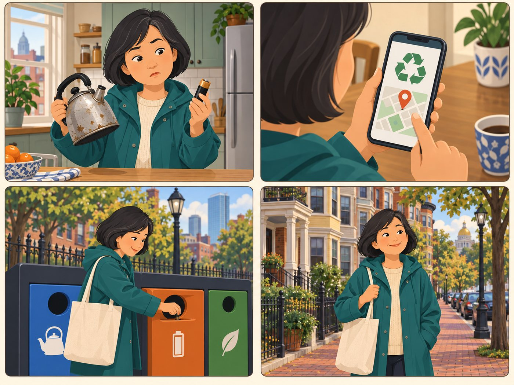

# Recycler

**Wants to recycle an item correctly.**

| | |
|---|---|
| Rank | 9 of 15 |
| Likelihood | 2 of 5 |
| Scope | Roadmap, not in pilot |
| Source | Seen in Figma |

[Back to the index](README.md)

## Story

1. A worn-out kettle and a dead battery.
2. One picture card and a link to the City rule.
3. She puts each item in the right bin.
4. She walks home with an empty bag.

*Illustration of a fictional person. It is not a photo and not a real user.*

## Source

The Recycle card is in the Figma Decision Tool (Seen in Figma). No Recycle flow exists in Figma, and no source describes one. The steps here are proposed.

## Why this rank

It is a named card, so people will tap it. But Recycle is not one of the three pilot Activities. Expect "where do I put this?" questions.

## Goals

- Know the right bin or drop-off
- Avoid contamination
- Learn what is not recyclable

## Main journey

1. **Start.** Has a worn-out item.
2. **Choose.** Taps Recycle.
3. **Learn.** Reads one plain rule for the item.
4. **Find.** Sees a City drop-off or rule link.
5. **Go.** Follows the City link.

## Edge cases

- Rules change by town: link to the City page, do not copy it.
- Hazardous items: show a warning and the City link.
- Item can be repaired: offer Repair first.

## Success measure

No wrong advice. Every Recycle answer links to a City source with a check date.

## Open decision

Keep Recycle as roadmap, or show a link-only card?
