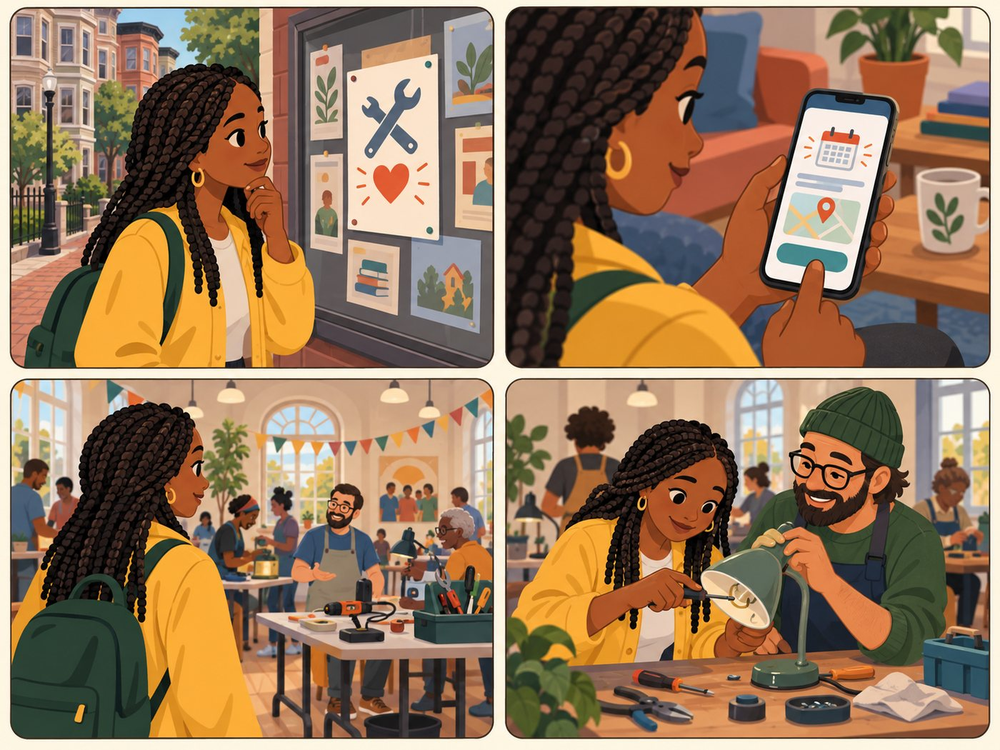

# Event attendee

**Wants a repair clinic or event.**

| | |
|---|---|
| Rank | 10 of 15 |
| Likelihood | 2 of 5 |
| Scope | Roadmap, not in pilot |
| Source | Seen in Figma |

[Back to the index](README.md)

## Story

1. A flyer for a repair clinic.
2. The app links to the host page for the date.
3. A hall full of tables, tools and volunteers.
4. A volunteer coach helps her fix a lamp.

*Illustration of a fictional person. It is not a photo and not a real user.*

## Source

Seen in Figma: Fixit Clinic event, Register now, Add to calendar, volunteer coach match. Team docs: Denise finds clinics on Eventbrite. Events, registration and stored data are outside the pilot.

## Why this rank

Clinics are the heart of Denise's journey and of the Figma flow. But they need dates, sign-up and upkeep that the pilot excludes.

## Goals

- Find the next clinic near home
- Know it is free
- Get matched with a volunteer coach

## Main journey

1. **Start.** Hears about a clinic.
2. **Search.** Sees Free section first.
3. **Open.** Reads date, place, phone.
4. **Register.** Sends an email (roadmap).
5. **Prepare.** Fills a repair form (roadmap).

## Edge cases

- Event dates go stale fast: pilot links to the host page only.
- Star rating is for the host, not the event.
- Registration stores personal data: roadmap.

## Success measure

In the pilot: the link opens the right host page. Later: registration works and the date is true.

## Open decision

Link-only events in the pilot, or none?
