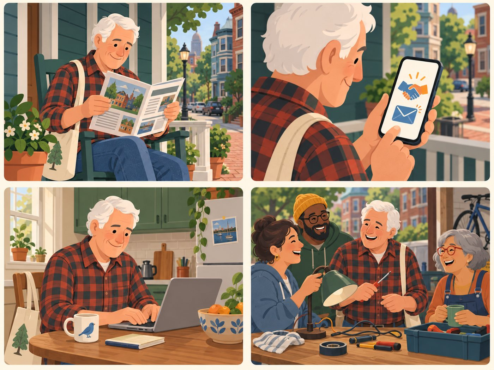

# Community joiner

**Wants to join or help the movement.**

| | |
|---|---|
| Rank | 11 of 15 |
| Likelihood | 2 of 5 |
| Scope | Roadmap, not in pilot |
| Source | Seen in Figma |

[Back to the index](README.md)

## Story

1. He reads about the group in a newsletter.
2. The Join card gives a contact link.
3. He writes a short email.
4. He joins neighbours at the repair table.

*Illustration of a fictional person. It is not a photo and not a real user.*

## Source

The Join card and the FAQ "How do I join this community" are in the Figma Decision Tool. No flow behind them was seen. The steps here are proposed.

## Why this rank

A card exists, so some people will tap it: volunteers, students, local groups. The pilot has no accounts, so Join cannot sign anyone up.

## Goals

- Learn how to take part
- Find a volunteer role
- Meet a local group

## Main journey

1. **Start.** Taps Join.
2. **Learn.** Reads what joining means.
3. **Choose.** Sees ways to help.
4. **Contact.** Gets an email or form link.
5. **Done.** Leaves the app.

## Edge cases

- No accounts: Join is a link to the team or to a host.
- Spam through a form: use an outside form, not our own.
- Volunteer coaches at clinics: a separate roadmap user.

## Success measure

Every Join tap ends at a working contact link. Zero sign-ups are stored in the app.

## Open decision

Keep Join as roadmap, or drop the card from the pilot?
