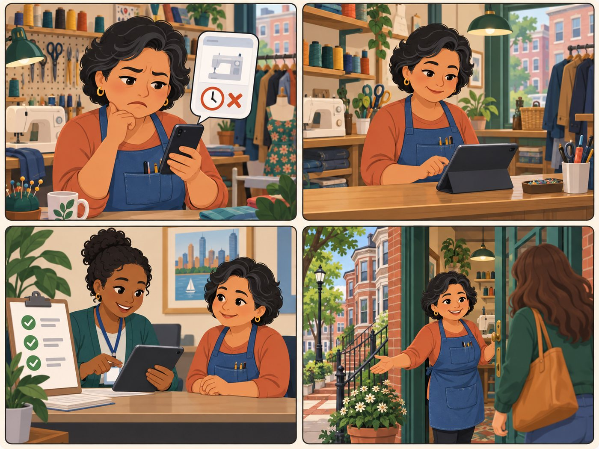

# Small repair shop owner

**Wants to be listed. Provider persona 1.**

| | |
|---|---|
| Rank | 12 of 15 |
| Likelihood | 2 of 5 |
| Scope | Maintainer task |
| Source | Proposed |

[Back to the index](README.md)

## Story

1. Lena sees a wrong closing time on her listing.
2. She sends a correction through an outside form.
3. A maintainer checks her source.
4. The fix goes live. A customer walks in.

*Illustration of a fictional person. It is not a photo and not a real user.*

## Source

PROPOSED. The UX Strategy doc plans 2 service-provider personas but names none. Figma note: providers come from the Zero Waste Directory and Google Places.

## Why this rank

Shops are the main source of paid repair. They need the listing to be true and easy to correct, but the pilot has no provider login.

## Goals

- Be found by nearby residents
- Fix a wrong phone or hours
- Be removed on request

## Main journey

1. **Start.** Finds her shop in the app.
2. **Check.** Sees a wrong closing time.
3. **Ask.** Sends a correction to the team (outside form).
4. **Review.** A maintainer checks the source.
5. **Done.** Next catalog build shows the fix.

## Edge cases

- No provider login in the pilot: corrections go by form or issue.
- Shop asks to be removed: a withdrawn list hides it.
- Shop wants to pay for rank: not allowed.

## Success measure

A correction is live in the next catalog build within 14 days. Zero listings stay after a removal request.

## Open decision

Is "Small shop owner" the right first provider persona?
