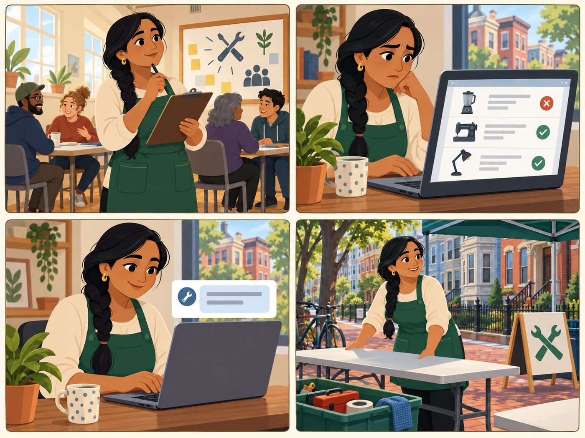

# Repair nonprofit organiser

**Runs clinics or a donation site. Provider persona 2.**

| | |
|---|---|
| Rank | 13 of 15 |
| Likelihood | 2 of 5 |
| Scope | Maintainer task |
| Source | Proposed |

[Back to the index](README.md)

## Story

1. Priya plans the next clinic.
2. She sees the listing is out of date.
3. She sends new hours by form.
4. A reviewer approves. She sets up tables.

*Illustration of a fictional person. It is not a photo and not a real user.*

## Source

PROPOSED. Modelled on Boston Building Resources and Artisans Asylum, named in the team docs and in Figma. The MVP doc lists "Sam Patel" and "Alex Morgan" as deferred personas; Their details were not read, and they may be this role.

## Why this rank

Clinics and donation sites hold the free options residents want most. Their hours, items and dates change often.

## Goals

- Keep hours and accepted items true
- Tell residents about a clinic
- Get matched volunteers (later)

## Main journey

1. **Start.** Plans a clinic.
2. **Check.** Sees the listing is out of date.
3. **Send.** Sends new hours by form.
4. **Review.** A maintainer checks and approves.
5. **Done.** Listing shows a new check date.

## Edge cases

- Events are outside the pilot: link to the organiser page.
- Many branches: one listing per branch.
- Organiser wants a login: roadmap.

## Success measure

Hours on listings match the organiser page at each monthly check.

## Open decision

Is "Nonprofit organiser" the right second provider persona?
